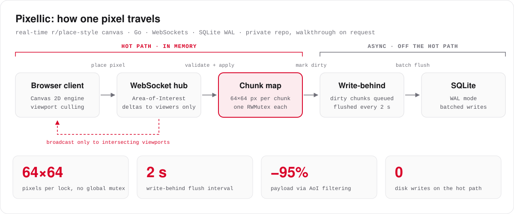

<picture>
  <source media="(prefers-color-scheme: dark)" srcset="assets/header-dark.svg">
  
</picture>

  
  
  

I write Go for a living and for fun. By day: healthcare backends and decentralized identity. By night: multiplayer engines where every 64×64 chunk gets its own lock.

### 🔬 Under the hood

Most of my Go lives in private repos, so here is one of them on a single slide. Happy to walk through the code.

<picture>
  <source media="(prefers-color-scheme: dark)" srcset="assets/pixellic-dark.svg">
  
</picture>

### 🧰 Daily drivers

<picture>
  <source media="(prefers-color-scheme: dark)" srcset="https://skillicons.dev/icons?i=go,ts,nodejs,postgres,mongodb,redis,docker,kubernetes,aws,githubactions,linux,py,react&theme=dark&perline=13">
  
</picture>

### 📈 Activity

<!-- Generated daily by .github/workflows/metrics.yml -->
 

<!-- Generated daily by .github/workflows/snake.yml into the "output" branch -->
<picture>
  <source media="(prefers-color-scheme: dark)" srcset="https://raw.githubusercontent.com/Gravery/Gravery/output/github-snake-dark.svg">
  
</picture>

### 🗒️ Field notes

| | |
| :-: | --- |
| 🎮 | Wrote the game server for **PartyHub** in Go: Hanabi, ITTO and Cards Against Humanity, with a 45 s reconnect window so a flaky phone never loses its seat |
| 🗳️ | Squeezed 28 years of Brazilian election data (~1M voting machines) into a DuckDB + Parquet warehouse |
| 🧠 | Built **PsychDash**, an offline-first clinic app where patient data never leaves the machine |
| 🏁 | Competed in the ICPC-style Brazilian Programming Marathon (2021) |
| 🇯🇵 | Learning Japanese, one kanji at a time |
